# Equilouds 99 Loops

**Mesmerizing and adorable code based animations for free.**

99 seamless motion designs written in plain code: 78 canvas loops and 21 animated buttons, grouped into 13 themes. No libraries, no build step, no renders. Every loop is a single HTML file you can copy, recolor and use at any size, commercial projects included.

**[Open the live gallery](https://uschweerlambers-art.github.io/equilouds-99-loops/)** · Made by [Uwe Schweer-Lambers / EQUILOUD](https://uweschweerlambers.de)

## How to use a loop

1. Open any file in [`loops/`](loops/) or click a tile in the gallery and press **Copy code**.
2. Save it as `.html` and open it in a browser.
3. Change the colors in `P`, the size in `W` and `H`, the loop length in `DUR`.

Every canvas loop is a pure function of time: `draw(c, t, W, H, P)` with `t` from 0 to 1. All motion runs in whole multiples of the 12 second period, so the last frame flows into the first. Record the screen or export it frame by frame for video.

Buttons are pure CSS. Colors run through `--bg`, `--fg` and `--accent`; size scales with `font-size`.

## The collection

### Plexus & networks (4)

| # | Name | Type | Description |
|---|---|---|---|
| 01 | [Plexus Orbit](loops/01-plexus-orbit.html) | Canvas | Points on orbits that connect when they come close. The classic for tech titles, here exactly loopable. |
| 02 | [Plexus Sphere](loops/02-plexus-sphere.html) | Canvas | 140 points on a rotating sphere, connected by their true 3D distances. |
| 03 | [Plexus Wave](loops/03-plexus-wave.html) | Canvas | A mesh of points rolling into the depth like a wave. |
| 04 | [Plexus Hex](loops/04-plexus-hex.html) | Canvas | A plexus network caught inside a hexagon. Equiloud as a data structure. |

### Code & data (3)

| # | Name | Type | Description |
|---|---|---|---|
| 05 | [Code Rain](loops/05-code-rain.html) | Canvas | Falling columns of glyphs at three speeds. The Matrix classic, seamless. |
| 06 | [Code Scroll](loops/06-code-scroll.html) | Canvas | An editor scrolling through abstract code with line numbers and syntax colors. |
| 07 | [Terminal Type](loops/07-terminal-type.html) | Canvas | A terminal typing a render command. For developer content and tutorials. |

### Technology (8)

| # | Name | Type | Description |
|---|---|---|---|
| 08 | [Circuit Board](loops/08-circuit-board.html) | Canvas | Circuit traces carrying signal pulses at three speeds. |
| 09 | [Chip Pulse](loops/09-chip-pulse.html) | Canvas | A microchip sending signals out along 24 traces. |
| 10 | [Signal Bars](loops/10-signal-bars.html) | Canvas | A mirrored LED equalizer. Fits music, podcasts and audio brands. |
| 11 | [Radial EQ](loops/11-radial-eq.html) | Canvas | 72 bars in a circle, like an audio visualizer around a logo. |
| 12 | [Radar HUD](loops/12-radar-hud.html) | Canvas | A radar screen with a sweep and targets lighting up. |
| 13 | [Gear Pair](loops/13-gear-pair.html) | Canvas | Two gears with 12 and 20 teeth meshing cleanly. For process and engineering topics. |
| 14 | [Loader Arcs](loops/14-loader-arcs.html) | Canvas | Four arcs spinning in opposite directions and contracting. A loading indicator with character. |
| 15 | [Infinity Trail](loops/15-infinity-trail.html) | Canvas | Two comets chasing each other on a lemniscate. Good as a loader or logo accent. |

### Grids (6)

| # | Name | Type | Description |
|---|---|---|---|
| 16 | [Hex Pulse](loops/16-hex-pulse.html) | Canvas | A honeycomb grid with a pressure wave running outward from the center. The Equiloud hexagon as a surface. |
| 17 | [Grid Warp](loops/17-grid-warp.html) | Canvas | A grid bent by a shock wave from the center. Nodes light up on the crest. |
| 18 | [Vector Field](loops/18-vector-field.html) | Canvas | Short strokes trace a flow field that keeps realigning. |
| 19 | [Dot Magnet](loops/19-dot-magnet.html) | Canvas | A dot grid pulled toward a wandering magnet. |
| 20 | [Pixel Wave](loops/20-pixel-wave.html) | Canvas | Pixel blocks appearing and vanishing from three overlaid waves. |
| 21 | [Synth Horizon](loops/21-synth-horizon.html) | Canvas | A retro sun over a grid running endlessly toward the camera. The 80s in 12 seconds. |

### Topography (5)

| # | Name | Type | Description |
|---|---|---|---|
| 22 | [Contour Drift](loops/22-contour-drift.html) | Canvas | Contour lines flowing slowly out of the center, breathing as they go. Calm enough for subtitles. |
| 23 | [Ridge Lines](loops/23-ridge-lines.html) | Canvas | Stacked lines like a mountain profile. Three overlaid waves keep the motion calm. |
| 24 | [Topo Map](loops/24-topo-map.html) | Canvas | Real contour lines via marching squares from a moving landscape. Every fifth line is emphasized, like on a map. |
| 25 | [Sliced Topo](loops/25-sliced-topo.html) | Canvas | A block of terrain made of 18 thin slices in isometric view, like an architectural model. Hills and waves drift slowly through the relief. |
| 26 | [Contour Island 3D](loops/26-contour-island-3d.html) | Canvas | Contour lines of an island, stacked in 3D. Four peaks grow and shrink, the camera pans along, and hidden lines disappear behind the hills. |

### 3D solids (9)

| # | Name | Type | Description |
|---|---|---|---|
| 27 | [Noise Cube](loops/27-noise-cube.html) | Canvas | A cube made of 6 × 6 × 6 small cubes. A noise field makes them shrink, vanish and reappear. Set N = 12 for 1728 cubes. |
| 28 | [Metaballs 3D](loops/28-metaballs-3d.html) | Canvas | Five glossy spheres that meet, melt into one shape and pull apart again. Every pixel is lit with diffuse light and a highlight. |
| 29 | [Iso Cubes](loops/29-iso-cubes.html) | Canvas | Isometric columns growing to the beat of a wave. A small city made of data. |
| 30 | [Wire Cube](loops/30-wire-cube.html) | Canvas | Two wireframe cubes in true 3D projection; the inner one spins twice as fast the other way. |
| 31 | [Globe Network](loops/31-globe-network.html) | Canvas | A globe made of 2261 dots. Connection arcs grow between cities and fade away again; the orange lines start in Bielefeld. |
| 32 | [Pyramid Spin](loops/32-pyramid-spin.html) | Canvas | A solid flat-shaded pyramid floating above its shadow. |
| 33 | [Cube Procession](loops/33-cube-procession.html) | Canvas | Cubes march around an impossible triangle. A tribute to Oscar Reutersvärd, who invented impossible figures. |
| 34 | [Diamond Gem](loops/34-diamond-gem.html) | Canvas | A faceted diamond with 25 faces. The brightest facet flashes orange. |
| 35 | [Menger Sponge](loops/35-menger-sponge.html) | Canvas | A level-2 Menger sponge built from 400 cubes with real flat shading. The large tunnels glow orange inside. |

### Squares (5)

| # | Name | Type | Description |
|---|---|---|---|
| 36 | [Square Tunnel](loops/36-square-tunnel.html) | Canvas | Squares fly out of the depth toward the camera and twist open. Great as an intro behind a logo. |
| 37 | [Square Whirl](loops/37-square-whirl.html) | Canvas | 40 nested, twisted squares form a whirl. |
| 38 | [Op-Art Warp](loops/38-op-art-warp.html) | Canvas | A checkerboard inflated by a lens from the center. Op art after Vasarely. |
| 39 | [Tangram](loops/39-tangram.html) | Canvas | The seven classic tangram pieces switch between square, triangle and parallelogram. While rebuilding they briefly fly apart and spin. |
| 40 | [Slide Puzzle](loops/40-slide-puzzle.html) | Canvas | The classic 15-puzzle on 4 × 4. 24 moves shuffle it, the same 24 moves in reverse solve it again. Tiles in the right place glow white. |

### Triangles (5)

| # | Name | Type | Description |
|---|---|---|---|
| 41 | [Low Poly Drift](loops/41-low-poly-drift.html) | Canvas | A triangle mesh with real per-face lighting. Equiloud’s polymesh look in 2D. |
| 42 | [Triangle Flip](loops/42-triangle-flip.html) | Canvas | A triangle grid whose faces flip over in a wave. |
| 43 | [Kaleidoscope](loops/43-kaleidoscope.html) | Canvas | Triangles mirrored twelve times, like in a kaleidoscope. |
| 44 | [Chevron March](loops/44-chevron-march.html) | Canvas | Zigzag bands marching steadily downward. Loud, graphic, good for social clips. |
| 45 | [Hex Assemble](loops/45-hex-assemble.html) | Canvas | Six triangles fly in, form a hexagon, turn and fly out again. An Equiloud logo reveal. |

### Fractals (6)

| # | Name | Type | Description |
|---|---|---|---|
| 46 | [Sierpinski Zoom](loops/46-sierpinski-zoom.html) | Canvas | An endless zoom into the Sierpinski triangle. After 12 seconds everything is twice as big and exactly the same. |
| 47 | [Koch Morph](loops/47-koch-morph.html) | Canvas | A triangle growing into a Koch snowflake and back. |
| 48 | [Hexaflake](loops/48-hexaflake.html) | Canvas | A hexagon made of hexagons made of hexagons, breathing as it turns. |
| 49 | [Julia Drift](loops/49-julia-drift.html) | Canvas | A Julia set whose parameter travels once around a circle. Mathematics as a color field. |
| 50 | [Fractal Tree](loops/50-fractal-tree.html) | Canvas | A recursive tree with 2048 branches swaying in the wind. |
| 51 | [Spirograph](loops/51-spirograph.html) | Canvas | A hypotrochoid with seven loops, traced by two light trails. |

### Circles (9)

| # | Name | Type | Description |
|---|---|---|---|
| 52 | [Halftone Swell](loops/52-halftone-swell.html) | Canvas | Halftone dots whose size follows a wave. Like screen printing in motion. |
| 53 | [Circle Pack](loops/53-circle-pack.html) | Canvas | Densely packed circles pulsing as a wave from the center. |
| 54 | [Moiré Rings](loops/54-moir-rings.html) | Canvas | Two ring fields circling against each other. The interference pattern appears by itself. |
| 55 | [Orbit Study](loops/55-orbit-study.html) | Canvas | A central node with 22 satellites on fine lines. Each orbits once or twice per loop in either direction; the large ones glow orange. |
| 56 | [Truchet Flip](loops/56-truchet-flip.html) | Canvas | Quarter-circle tiles flipping one after another. New paths keep appearing. |
| 57 | [Check Draw](loops/57-check-draw.html) | Canvas | Circle draws, check follows, a short pop. The success state for forms. |
| 58 | [Pendulum Wave](loops/58-pendulum-wave.html) | Canvas | 15 pendulums with 4 to 18 swings per loop. After 12 seconds they line up again. |
| 59 | [Bounce Row](loops/59-bounce-row.html) | Canvas | Five balls bouncing out of phase, squashed on impact. Classic squash and stretch. |
| 60 | [Newton’s Cradle](loops/60-newton-s-cradle.html) | Canvas | The Newton’s cradle classic. Three impacts per loop. |

### Organic (11)

| # | Name | Type | Description |
|---|---|---|---|
| 61 | [Mesh Gradient](loops/61-mesh-gradient.html) | Canvas | Soft color fields flowing into each other. The calmest background in the collection. |
| 62 | [Aurora Bands](loops/62-aurora-bands.html) | Canvas | Glowing bands drifting across the sky like an aurora. Additive light, best on a dark ground. |
| 63 | [Silk Strings](loops/63-silk-strings.html) | Canvas | 48 threads with a color gradient form a floating ribbon. |
| 64 | [Wind Lines](loops/64-wind-lines.html) | Canvas | Dashed flow lines at three speeds. Movement without restlessness, good behind body text. |
| 65 | [Rain Lines](loops/65-rain-lines.html) | Canvas | Slanted rain at three speeds. Atmospheric under titles. |
| 66 | [Kelp Strands](loops/66-kelp-strands.html) | Canvas | Kelp swaying in the current while bubbles rise. |
| 67 | [Ripple Pond](loops/67-ripple-pond.html) | Canvas | Ripples spreading in perspective across a water surface. |
| 68 | [Metaballs](loops/68-metaballs.html) | Canvas | Seven soft drops merging and separating again. |
| 69 | [Blob Morph](loops/69-blob-morph.html) | Canvas | Three soft shapes wobbling into each other. Organic and friendly. |
| 70 | [Cell Division](loops/70-cell-division.html) | Canvas | A cell dividing into four and coming back together. |
| 71 | [DNA Helix](loops/71-dna-helix.html) | Canvas | A double helix turning with true depth sorting. |

### Space (7)

| # | Name | Type | Description |
|---|---|---|---|
| 72 | [Star Warp](loops/72-star-warp.html) | Canvas | Stars stretch into lines like a jump into hyperspace. |
| 73 | [Dot Tunnel](loops/73-dot-tunnel.html) | Canvas | Rings of dots twisting as you fly through the tunnel. |
| 74 | [Spiral Galaxy](loops/74-spiral-galaxy.html) | Canvas | 900 stars in three spiral arms that twinkle and turn once per loop. |
| 75 | [Black Hole](loops/75-black-hole.html) | Canvas | 600 particles in an accretion disk, faster inside than outside. |
| 76 | [Planet Rings](loops/76-planet-rings.html) | Canvas | A ringed planet with storm spots and a moon disappearing behind it. |
| 77 | [Solar System](loops/77-solar-system.html) | Canvas | Five planets with 1 to 6 orbits per loop. |
| 78 | [Orbit Rings](loops/78-orbit-rings.html) | Canvas | Three tilted orbits with satellites at different tempos. Works as a loading or waiting state. |

### Buttons (21)

| # | Name | Type | Description |
|---|---|---|---|
| 79 | [Shine Sweep](loops/79-shine-sweep.html) | CSS | A light reflection sweeps across the surface regularly, faster on hover. |
| 80 | [Orbit Border](loops/80-orbit-border.html) | CSS | A point of light circles the border. On hover it races. |
| 81 | [Pulse Ring](loops/81-pulse-ring.html) | CSS | Two rings pulse outward and draw attention to the call to action. |
| 82 | [Arrow Nudge](loops/82-arrow-nudge.html) | CSS | The arrow nudges to the right. On hover the button fills. |
| 83 | [Liquid Fill](loops/83-liquid-fill.html) | CSS | Liquid sloshes inside the button. On hover it fills up. |
| 84 | [Neon Breath](loops/84-neon-breath.html) | CSS | A neon frame slowly breathing in and out. |
| 85 | [Wave Link](loops/85-wave-link.html) | CSS | A text link with a travelling wave instead of an underline. |
| 86 | [Hex Badge](loops/86-hex-badge.html) | CSS | A hexagon button with a rotating rim in the Equiloud look. Fills on hover. |
| 87 | [Sending Dots](loops/87-sending-dots.html) | CSS | A sending state with hopping dots. Ideal for contact forms. |
| 88 | [Outline Draw](loops/88-outline-draw.html) | CSS | The frame draws itself clockwise and disappears again. On hover it stays. |
| 89 | [3D Press](loops/89-3d-press.html) | CSS | A button with depth that floats slightly and really presses in on click. |
| 90 | [Text Roll](loops/90-text-roll.html) | CSS | The label rolls up and is replaced by a copy. Accent color on hover. |
| 91 | [Terminal Prompt](loops/91-terminal-prompt.html) | CSS | A command-line button with a blinking cursor. |
| 92 | [Glitch](loops/92-glitch.html) | CSS | Occasional RGB glitches, frantic on hover. |
| 93 | [Gradient Flow](loops/93-gradient-flow.html) | CSS | A gradient flowing endlessly through the button. |
| 94 | [Ripple Fill](loops/94-ripple-fill.html) | CSS | A drop pulses in the center; on hover a circle fills the surface. |
| 95 | [Split Fill](loops/95-split-fill.html) | CSS | Two halves slide in from left and right on hover. |
| 96 | [Circle Arrow](loops/96-circle-arrow.html) | CSS | A round icon button with a rotating dashed ring. |
| 97 | [Play Button](loops/97-play-button.html) | CSS | A play button with a pulsing ring. For showreels and videos. |
| 98 | [HUD Corners](loops/98-hud-corners.html) | CSS | Sci-fi corners that close into a frame on hover. |
| 99 | [Motion Toggle](loops/99-motion-toggle.html) | CSS | A switch with a springy knob, good for settings like motion on or off. |

## Deutsch

**Equilouds 99 Loops** sind 99 nahtlose Motion-Designs als reiner Code: Hintergründe, Formanimationen und animierte Buttons. Alles ist gratis und frei kopierbar, auch für kommerzielle Projekte. Die Galerie lässt sich zwischen Deutsch und Englisch umschalten.

## License

[MIT](LICENSE). Use the code freely in personal and commercial work. A mention of Equiloud is appreciated but not required.
